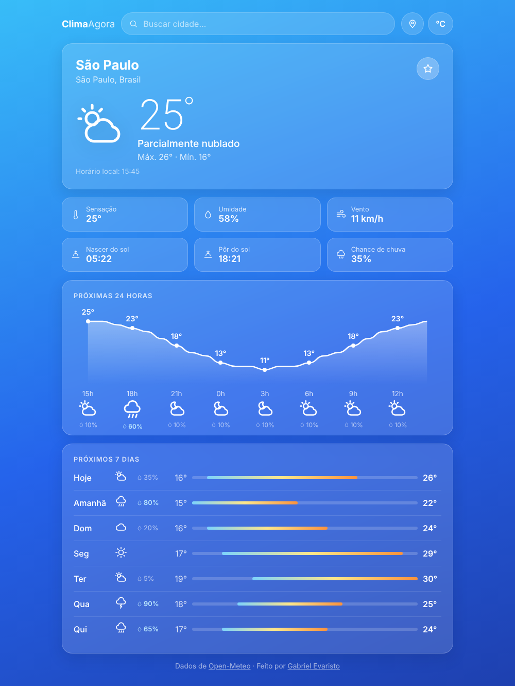

<h1 align="center">🌤️ Clima Agora</h1>

<p align="center">
  App de previsão do tempo com busca de cidades, gráfico das próximas 24 horas, previsão da semana e cidades favoritas.
</p>

<p align="center">
  <a href="https://gabrielevaristo77.github.io/clima-agora/">
    
  </a>
  
  
  
  <a href="https://github.com/GabrielEvaristo77/clima-agora/actions/workflows/testes.yml">
    
  </a>
</p>

<p align="center">
  <a href="https://gabrielevaristo77.github.io/clima-agora/">
    
  </a>
</p>

---

## ✨ Funcionalidades

- **Busca de cidades com sugestões** enquanto você digita, com navegação pelas setas do teclado
- **Clima atual**: temperatura, sensação térmica, umidade, vento, nascer e pôr do sol
- **Gráfico das próximas 24 horas** desenhado em SVG, com ícones e chance de chuva
- **Previsão de 7 dias** com barras de mínima e máxima na mesma escala
- **Cidades favoritas** e última cidade vista, salvas no navegador
- **Usar minha localização**, pelo GPS do navegador
- **°C ou °F**, com um clique
- **Fundo que muda** com o tempo e o horário: ensolarado, nublado, chuva, tempestade ou noite
- **Estados de carregamento e erro**, com botão para tentar de novo
- Funciona no **celular**

## 🧠 O que aprendi fazendo

| Parte | O que pratiquei |
|---|---|
| Busca com sugestões | Esperar a pessoa parar de digitar (*debounce*) antes de chamar a API |
| Comunicação com a API | `fetch` com `async/await`, tempo limite com `AbortController` e mensagens de erro amigáveis |
| Respostas fora de ordem | Ignorar uma resposta antiga quando a pessoa já trocou de cidade |
| Gráfico de 24 horas | Converter temperaturas em coordenadas e desenhar uma curva em SVG |
| Código organizado | Separar em módulos: API, regras, ícones, favoritos e tela |
| Testes automáticos | Testar as regras com `node:test`, simulando a API, e rodar a cada envio com GitHub Actions |
| Acessibilidade | Lista de sugestões navegável por teclado, `aria-live` e textos alternativos |

## 🗂️ Estrutura

```
clima-agora/
├── index.html
├── css/estilo.css
├── js/
│   ├── app.js          liga a tela aos dados
│   ├── api.js          chamadas à Open-Meteo
│   ├── previsao.js     transforma a resposta da API no que a tela mostra
│   ├── clima.js        códigos de tempo → descrição e ícone
│   ├── icones.js       ícones em SVG
│   └── favoritos.js    preferências salvas no navegador
└── tests/              testes automáticos
```

## ▶️ Como rodar

Não precisa instalar nada. Como o projeto usa módulos JavaScript, abra com um servidor local:

```bash
python -m http.server
# depois acesse http://localhost:8000
```

Para rodar os testes (precisa do Node.js 20 ou mais recente):

```bash
npm test
```

## 🌐 Dados

A previsão vem da [Open-Meteo](https://open-meteo.com/), uma API gratuita que não exige cadastro nem chave de acesso.

---

<p align="center">
  Feito por <a href="https://github.com/GabrielEvaristo77">Gabriel Evaristo</a> · estudante de ADS na UNICID
</p>
